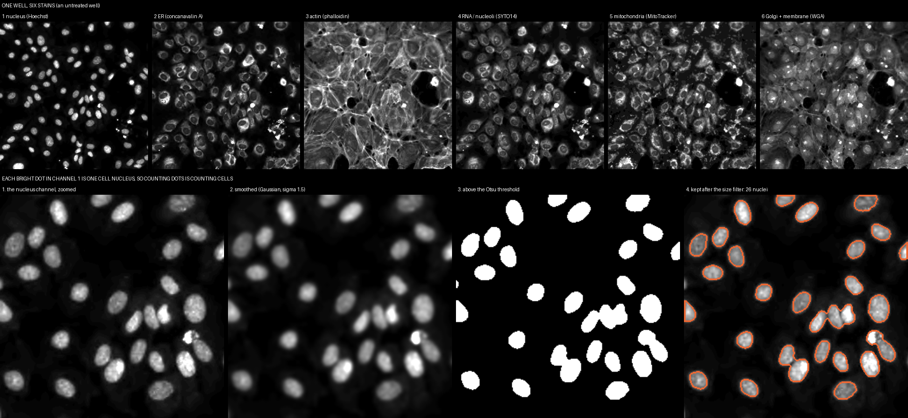
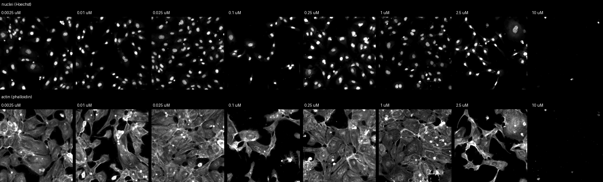
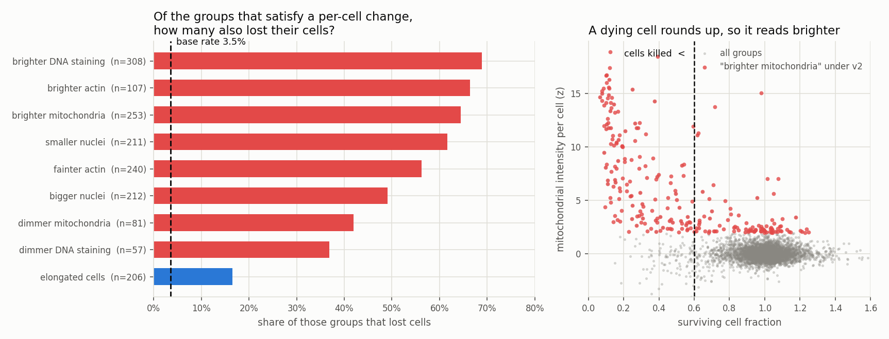
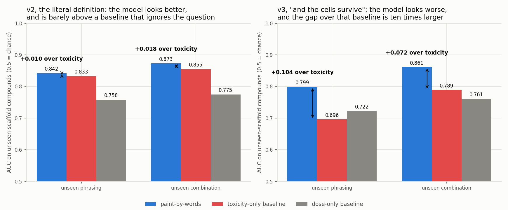
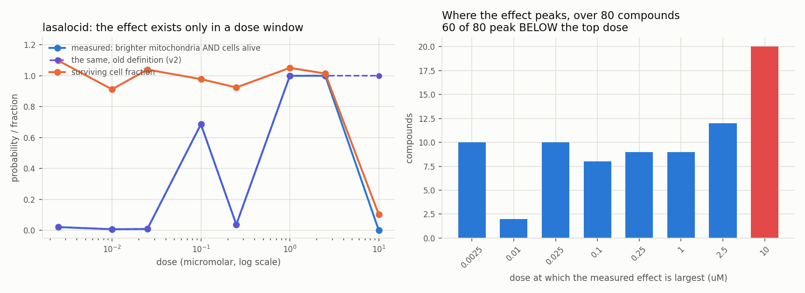

# paint-by-words

Ask a cell-image archive for a phenotype in plain English. Get a compound, a dose,
and the evidence. Or get a refusal.

```
$ python -m pbw.predict "make the mitochondria dimmer without killing the cells"
```

Every answer carries the model's score **next to the score of a baseline that never
reads the question**, because on this kind of data a good-looking phenotype model is
usually just a toxicity detector. Establishing that is most of what this project is.

Built on [RxRx3-core](https://huggingface.co/datasets/recursionpharma/rxrx3-core)
(Recursion): 56,700 compound wells, 1,671 compounds, 8 doses each, six fluorescent
channels per well, one human cell type.

---

## What the data is



Every bright dot in channel 1 is one cell nucleus, so counting dots is counting
cells. No CellProfiler column states "the cells died", so that number is measured
from the image: smooth, threshold (Otsu), label, filter by size, then divide by the
typical count for the same plate.

Counting is done by *total nuclear area / median single-nucleus area*, not by
connected components, because at high density nuclei touch and merge into one
component, so component counting undercounts exactly in the wells that matter.

The same compound at its eight doses, rendered on **one brightness scale** taken
from an untreated well, so the change you see is real and not a contrast artefact:



---

## The result

Compounds are split by **Bemis-Murcko scaffold**, so a test compound shares no ring
skeleton with any training compound. Five-seed ensemble, mean AUC over held-out
instructions.

| on unseen-scaffold compounds | unseen phrasing | unseen combination |
|---|---|---|
| **paint-by-words** | **.799** | **.861** |
| toxicity-only baseline | .696 | .789 |
| dose-only baseline | .722 | .761 |
| margin over toxicity | +.104 | +.072 |

**Refusal**, over 37 wishes that nothing in the archive satisfies versus 64 that
something does: **AUC .85**. At a threshold calibrated on validation compounds it
answers 89% of the answerable wishes and wrongly answers 38% of the impossible ones.

```
$ python -m pbw.predict "give me bigger nuclei and brighter mitochondria"
REFUSED  Nothing in this archive clears the calibrated threshold for this wish.
```

Which is right: under v3 that combination occurs only in dying cells, so no group in
the archive satisfies it.

The refusal statistic is the **mean of the top-10 scores, not the single best
score**. A maximum is an extreme-value statistic: it grows with the size of the
compound pool, so a threshold learned on one pool will not transfer to a larger one,
and one lucky group is enough to answer a wish nothing satisfies. Measured here,
going from 1,256 to 2,670 groups, the median best score for impossible wishes rose
.038 to .083 while the answerable ones did not move. Refusal AUC is .85 with the
top-10 mean and .79 with the maximum. The threshold is calibrated on validation
compounds, never on training compounds, where the model fits closely and the
threshold comes out far too strict.

The two baselines are the honest part of the table.

- **toxicity-only**: take the model's own prediction for *"kill most of the cells"*
  and use that single vector to score every other instruction.
- **dose-only**: rank by concentration.

### What this table does not say

**Top-1 is weak, and on unseen combinations the toxicity baseline beats it**: .105
for the model against .158 for toxicity-only, where AUC says the opposite (.861
against .789). The model orders the whole library better than toxicity does; it is
not yet better at picking the single best compound. That is the number a screening
user would feel first, and it is in `make eval` output by default.

**The bottleneck is chemistry, not language.** The same model scores .929 / .969 on
compounds it has seen and .799 / .861 on unseen scaffolds.

---

## The finding that cost most of the accuracy



An earlier label definition (`--definition v2`) scores **.842 / .873**, which looks
better than the .799 / .861 above. Its toxicity-only baseline scores **.833 / .855**,
so the behaviour-specific contribution is **+.010 / +.018** instead of
**+.104 / +.072**. Almost all of the apparent skill was "find the compounds that
kill cells". Both runs are in this repository; neither number is cherry-picked.

The cause is in the measurement, not the model. CellProfiler reports per-cell
averages over the cells it can segment, which are the survivors, and a dying cell
rounds up and reads **brighter** per unit area. Measured here, against a **3.5% base
rate** of cell loss, the share of groups satisfying a per-cell predicate that also
lost their cells runs from 37% to 69%, and for the three "brighter" predicates it is
**64% to 69%**. Only elongation is close to clean, at 16%.

So "make the mitochondria brighter" was substantially a synonym for "kill the
cells", and any model would learn the shortcut.

The fix is definition **v3**: every per-cell predicate becomes *"X **and** the cells
were not killed"*. The set of impossible wishes grows from 25 to 37, because
combinations like *"bigger nuclei and brighter mitochondria"* turn out to occur only
in dying cells.

```
python -m pbw.evaluate --definition v2   # reproduce the flattering, wrong number
python -m pbw.evaluate --definition v3   # the default
```

This is the one result here worth other people's attention: it applies to anyone
reading per-cell intensity features out of a Cell Painting archive.



---

## Why the output is a window and not a curve



```
p = sigmoid(b0 + b1*z) * sigmoid(c0 - softplus(b3)*z)
    ^ effect rises         ^ survival falls
```

Non-monotone on purpose. Under v3, **60 of the 80 compounds that ever brighten
mitochondria in living cells peak below the top dose**, because the top dose kills.
A monotone output cannot express a dose window and will prefer the toxic compound.

---

## A vision model as a second measuring instrument

2,000 (compound, dose) groups rendered as treated-beside-reference panels, scored
blind by a vision-language model, calibrated without labels, then checked against
the CellProfiler measurements behaviour by behaviour: cell loss .93, elongation .87,
dimmer DNA .81, down to brighter DNA .59 and smaller nuclei .58.

**This layer's result is negative and is reported as such.** Trained as a label
source it ranks unseen compounds *worse* than its own toxicity-only score
(−.02 / −.08). A vision model reading these panels delivers toxicity, cell number
and gross shape; it does not deliver subtle per-cell changes in surviving cells.
2,000 groups already cover **100% of the positives that exist in the archive** for
these behaviours, so the ceiling is the archive, not the labelling budget.

Protocol, the exact scoring prompt, and what was tried to fix it: **[critic/](critic/README.md)**.

---

## The failure it will not hide

The frozen sentence encoder does not encode direction:

```
"push the actin out to the edge"   vs  "pull the actin away from the edge"   0.76
"make the Golgi smoother"          vs  "patchy Golgi"                        0.65
```

Those are opposites, placed as near-synonyms, so the model answers the **opposite**
wish with high confidence: wrong and sure of itself, which is the worst failure a
screening tool can have.

`pbw.language.audit` checks every query and `predict` prints the result:

```
WISH: push the actin out to the cell edge
 ! The behaviour this wish is closest to was never trained: the archive has too few
   examples of it. The model will answer with the nearest trained concept instead,
   "pull the actin away from the cell edge" (cosine 0.76). That trained concept is
   its OPPOSITE.
```

The audit catches an untrained behaviour and an unseparated direction. It does
**not** reliably catch an out-of-scope wish: cosine to the nearest trained phrasing
runs 0.41-0.92 for genuine paraphrases and 0.12-0.53 for deliberately absurd
requests, so the two overlap. The real guard there is the refusal score, which is
calibrated and measured.

Full list of limitations: **[MODEL_CARD.md](MODEL_CARD.md)**.

---

## Install and run

Requires a local copy of RxRx3-core, which is **not** redistributed here (see
[ATTRIBUTION.md](ATTRIBUTION.md)).

```bash
pip install -e .
export P2I_DATA=/path/to/rxrx3_core          # metadata + CellProfiler features (+ image shards)

make counts      # nuclei counts, needs the image shards
make all         # groups table, instruction sets, 5 seeds, evaluation, figures
make baselines   # the same under the v2 definition, for the comparison above
make critic      # the vision-model label source and its control
make test

python -m pbw.predict "make the cells elongated without killing them"
python -m pbw.app                            # the demo
```

Every number and figure above comes from these commands. The CellProfiler features
alone are enough for everything except the cell-loss predicate and the image panels;
without the image shards that measurement is NaN and is masked, never assumed.

---

## What this is not

- It **selects from an archive**; it does not design a molecule.
- There is **no wet-lab validation**. Every number is retrospective.
- "Unseen" means **unseen chemistry under the same measurement conditions**. Nearly
  every compound in this archive appears in only one experiment, so an unseen-batch
  test cannot be separated from an unseen-compound test here. Measuring batch
  transfer needs an archive where the same compounds are run across sources, such as
  JUMP cpg0016.
- The behaviours are **eight image features**, not clinical or mechanistic
  endpoints.

---

## Credit

Work done as a postdoc at the University of Vermont in Prof. Josh Bongard's lab,
funded by the Army Research Office. Method background:
[arXiv:2509.10660](https://arxiv.org/abs/2509.10660),
[arXiv:2610.02247](https://arxiv.org/abs/2610.02247).

Dr. Nam H. Le — [drnamlabs.com](https://drnamlabs.com)
